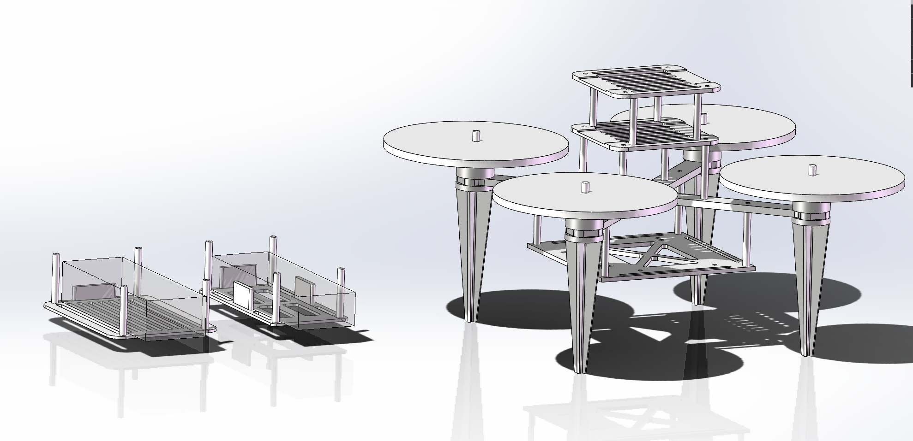
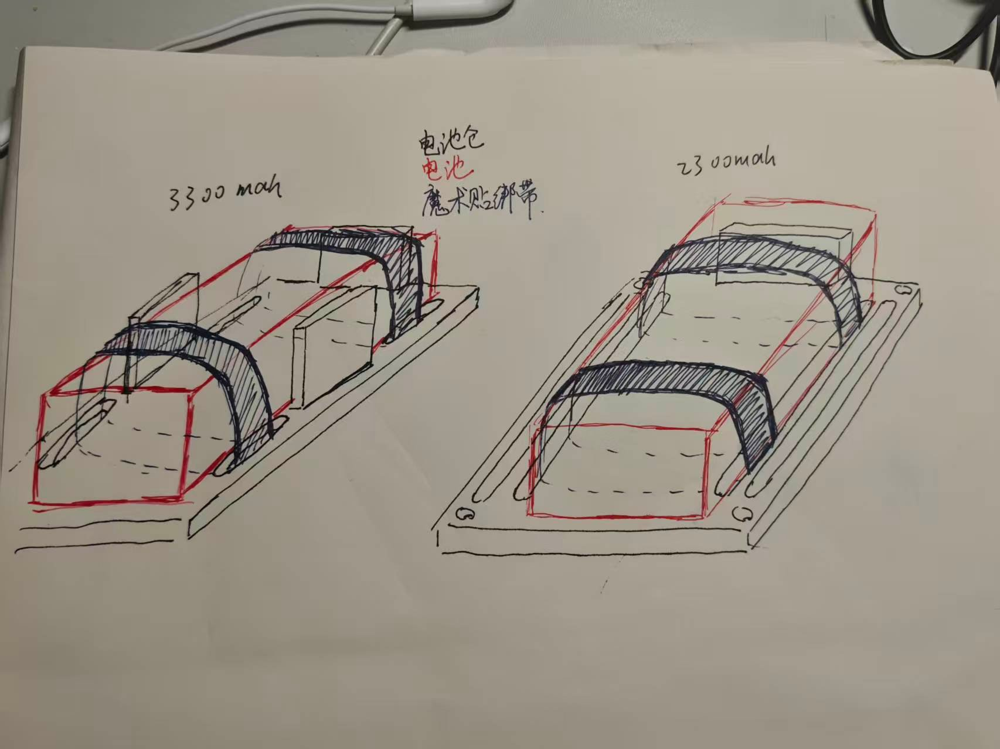
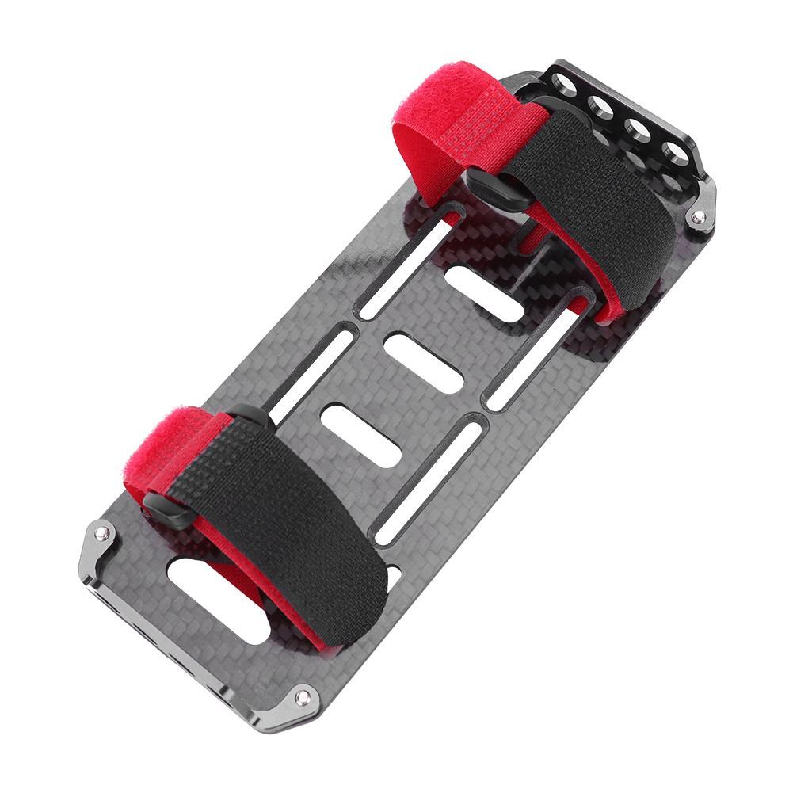
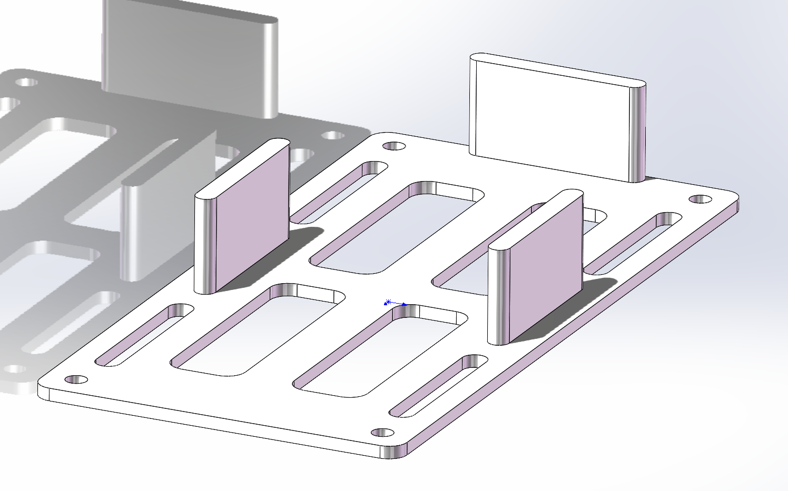
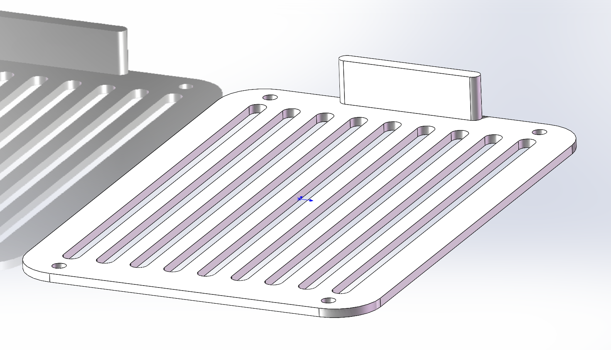

# 5 寸机 · SolidWorks 模型

5 寸机的 SolidWorks 版本，包含整机装配、各零件，以及**重新设计的电池固定方案，旧版 FreeCAD 文件保留。

*图 1　整机装配（`5inch_assembly.SLDASM`）*

## 一、模型清单

| 文件                                                                                      | 说明                                    |
| ------------------------------------------------------------------------------------------- | ----------------------------------------- |
| `5inch_assembly.SLDASM`                                                                   | 整机装配体，零件按同目录文件名引用      |
| `airframe.SLDPRT`                                                                         | 碳板机架主体                            |
| `10cm_kickstand.SLDPRT`                                                                   | 脚撑，3D 打印（PA6-CF）                 |
| `d435i_protector.SLDPRT`                                                                  | D435i 相机保护架，3D 打印（PA6-CF）     |
| `2300mah_double_battery_board.SLDPRT`                                                     | 双 2300mAh 电池固定板（**重新设计**）   |
| `3300mah_single_battery_board.SLDPRT`                                                     | 单块 3300mAh 电池固定板（**重新设计**） |
| `pixhawk6c_board&cover.SLDPRT`                                                            | Pixhawk 6C 安装板 + 盖板                |
| `nx_board.SLDPRT`                                                                         | Orin NX 安装板                          |
| `2300mah_battery_scratch.SLDPRT``3300mah_battery_scratch.SLDPRT`                          | 电池外形参考块，只用来校核空间          |
| `orin_nx_scratch.SLDPRT`                                                                  | Orin NX 本体参考块                      |
| `35mm_alum_col_scratch.SLDPRT``40mm_alum_col_scratch.SLDPRT``6mm_alum_col_scratch.SLDPRT` | 铝柱示意，装配校核用                    |
| `f60pro_motor_scratch.SLDPRT`                                                             | F60 Pro 电机示意                        |
| `51477-3_prop_scratch.SLDPRT`                                                             | 51477-3 桨叶示意                        |

## 二、电池固定方案

### 1. 出发点

*图 2　手绘草图*

1. **电池限位**——为避免电池的版上窜动，设有电池仓挡板；
2. **绑带要穿槽**——绑带从底板的长条槽里穿过去，确保电池被压紧在板面上；

### 2. 参考的成品方案

*图 3　市售碳纤电池托盘的固定方式：底板长条开槽 + 两根魔术贴绑带穿过槽压紧电池。*

“开槽穿绑带”这条思路来自现成的成品件（图 3），本版沿用它，但额外加了立板限位（图 4、图 5）。

### 3. 两块电池板

*图 4　`2300mah_double_battery_board.SLDPRT`：两节 2300mAh 并排，底板开长条槽，四周立起挡板把电池“关”在各自的仓位里，两条绑带分别压住一节电池。*

*图 5　`3300mah_single_battery_board.SLDPRT`：单块 3300mAh，底板密排长条槽，可以按电池实际位置挪动绑带；端部的立板做轴向限位。*

## 三、注意事项

1. **整机装配**直接打开 `5inch_assembly.SLDASM`。装配体按同目录文件名引用零件，**整个文件夹要一起拷走**，不要只拿单个文件；
2. solidworks版本：SOLIDWORKS 2024 32.0.1.0004
