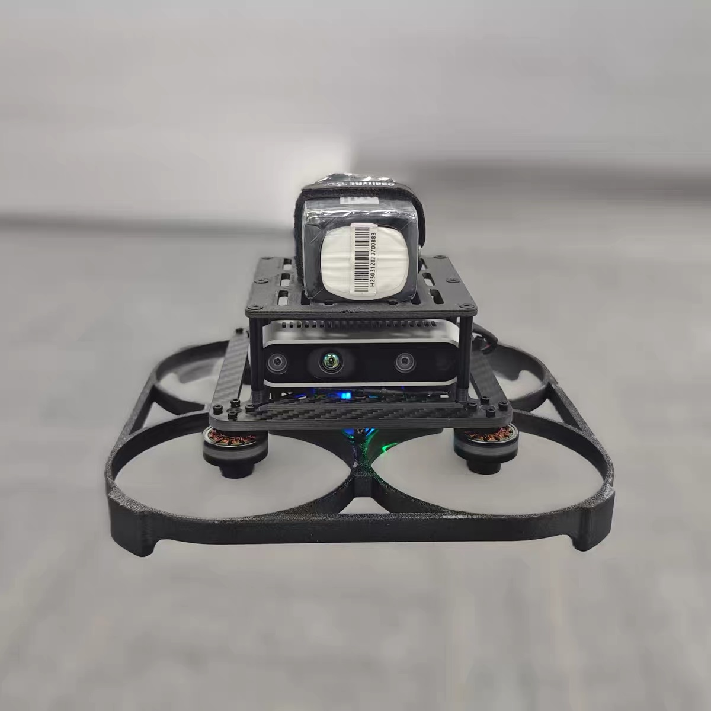
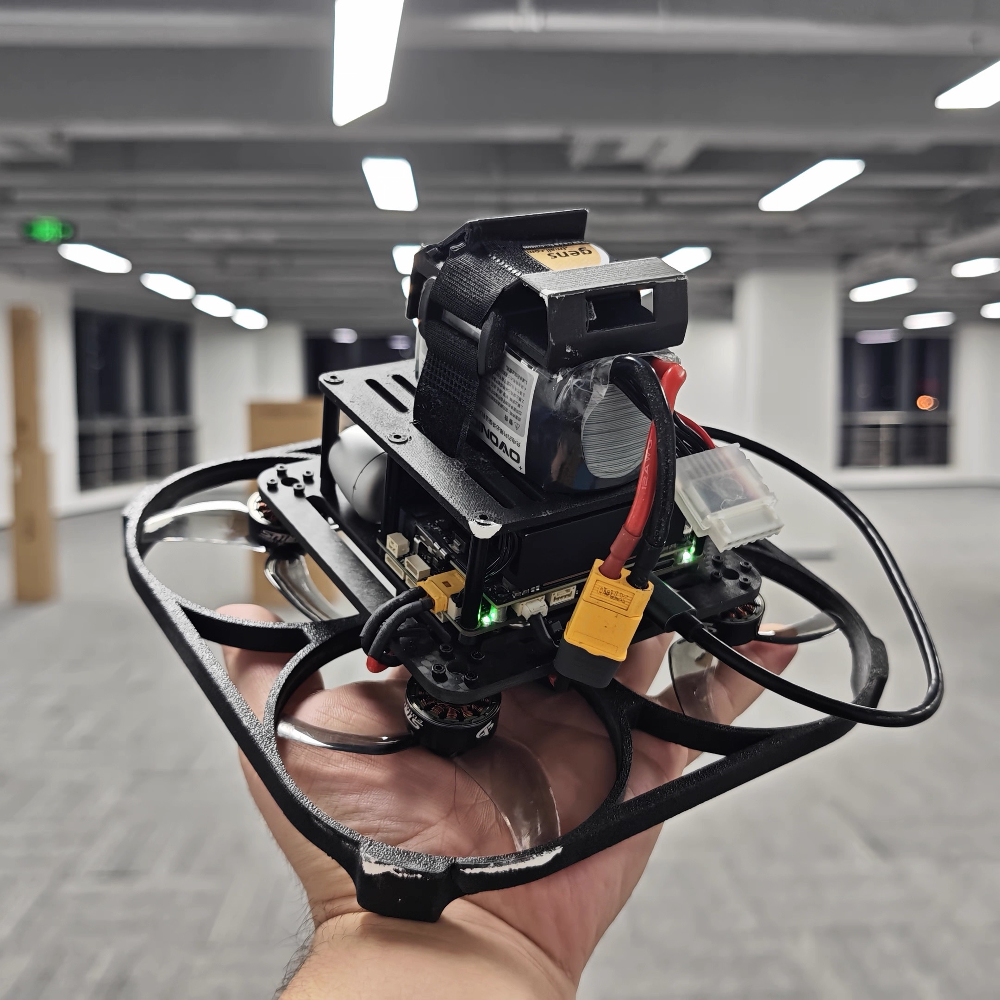

# 说明
参考淘宝上的产品，开发适用于香橙派5（rk3588s）和达妙科技orin nx的3.5寸机。下面展示主视图和商品展示： \ 

# 文件说明 - 香橙派5_based
1. base&protector 是**底座**，作为桨叶保护和支撑作用，计划采用PA6-DF 3D 打印。统一使用M3螺纹，和ESC以及下底板连接。和ESC连接的孔位有两个尺寸： 30.5 * 30.5 和 20 * 20
2. camera&computer-board 是**下底板**，机载电脑、电机和d435i都安装在上面，计划使用碳纤维板。除了电机安装孔位使用M2螺纹，其余地方都用M3。
3. cameraProtector 是**相机保护和固定**，用来连接下底板和相机，计划采用PA6-DF 3D打印。底部3个M3螺纹，用来和下底板连接，背部2个M3螺纹，用于安装相机
4. UpperProtector 是**上盖板**，用于保护机载电脑和相机，同时用于固定 1300mah 120C 6s 电池

# TODOs
## 香橙派 5
- [✔] 香橙派5 - 草稿
- [ing] 香橙派5 - 文件说明
- [ing] 香橙派5 - 装机验证
- [] 香橙派5 - 优化
- [] 香橙派5 - 零部件详细清单

## 达妙科技orin nx
- [] orin nx - 草稿
- [] orin nx - 装机验证
- [] orin nx - 优化
- [] orin nx - 零部件详细清单