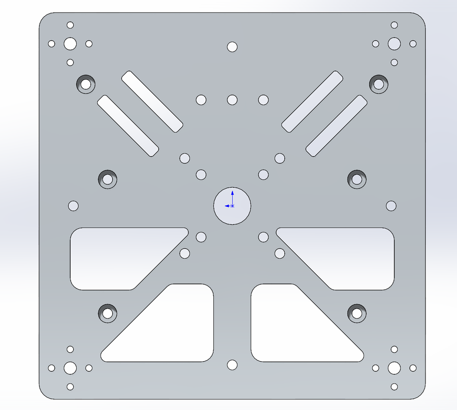
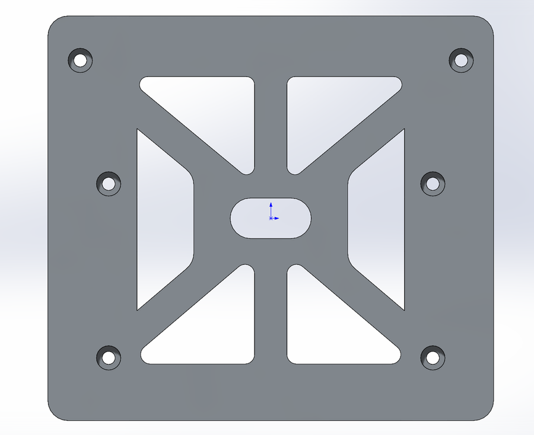
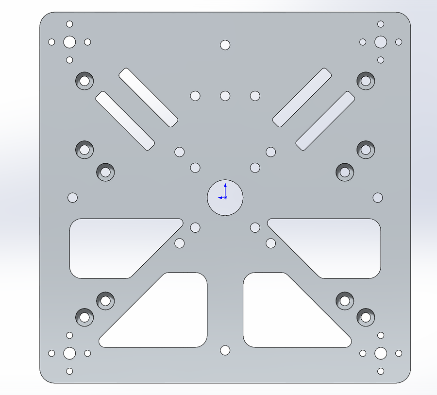
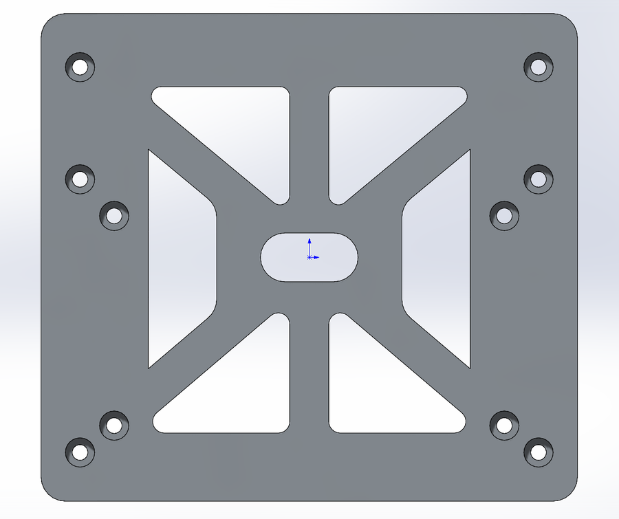
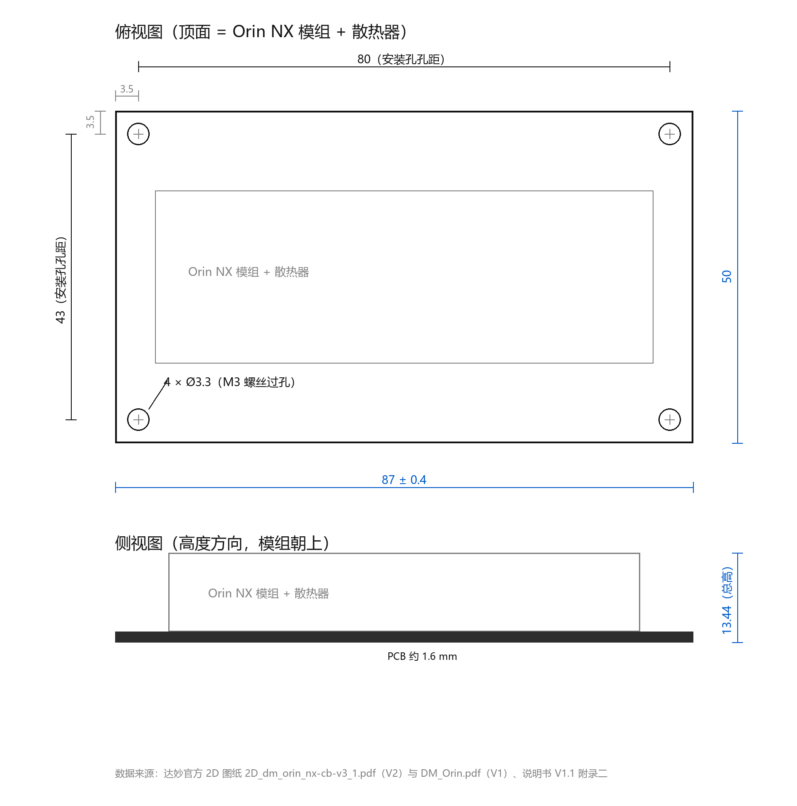

# Orin NX 版 3.5 寸机结构件

本目录是 3.5 寸四轴 **Orin NX 版本**的结构件：SolidWorks 2024 源文件（`.SLDPRT`）+ AP214 STEP 导出件（`steps/`）。
仓库根目录原有的 FreeCAD 模型保持。

---

## 1. 改动

基于原设计的下底板与上盖板，按达妙 **DM-ORIN NX** 载板的结构尺寸重做，另外做了一套两种机载电脑都能装的通用版：

1. **下底板 camera&computer-board**：新增 Orin 载板的 4 个安装孔（Ø3.2 通孔 + Ø6 沉头，孔距 **80 × 43**），并输出两个版本：
   - `_orin`：只保留 Orin 孔位，去掉香橙派 5 的 4 个孔；
   - `_general`：Orin 与香橙派 5 两套孔位都保留。
2. **上盖板 upperprotector**：它的安装孔与下底板存在绑定关系，所以一并改动，同样输出 `_orin` / `_general` 两版。
3. **base&protector、cameraprotector**：与机载电脑无关，设计直接沿用，只重新导出 STEP。

---

## 2. 文件清单

| 文件                            | 格式          | 外形（包络，mm） | 状态                           |
| --------------------------------- | --------------- | ------------------ | -------------------------------- |
| `camera&computer-board_orin`    | SLDPRT / STEP | 124 × 124 × 3  | **新设计**，仅 Orin            |
| `camera&computer-board_general` | SLDPRT / STEP | 124 × 124 × 3  | **新设计**，Orin + 香橙派 5    |
| `upperprotector_orin`           | SLDPRT / STEP | 110 × 100 × 3  | **新设计**，配 `_orin` 底板    |
| `upperprotector_general`        | SLDPRT / STEP | 110 × 100 × 3  | **新设计**，配 `_general` 底板 |
| `base&protector`                | SLDPRT / STEP | 208 × 208 × 34 | 沿用原设计                     |
| `cameraprotector`               | SLDPRT / STEP | 60 × 30 × 40   | 沿用原设计                     |

---

## 3. 外观

四张 SolidWorks 视图：

**下底板 `camera&computer-board_orin`**

**上盖板 `upperprotector_orin`**

**下底板 `camera&computer-board_general`**

**上盖板 `upperprotector_general`**

## 4. 达妙 DM-ORIN NX 载板结构参数

> 取自达妙官方 2D 图纸与说明书（V2 图纸 87 ± 0.4 × 50 × 13.44；V1 图纸 86.5 × 50 × 13.27，两版孔位相同）。

| 项目       | 数值                                                          |
| ------------ | --------------------------------------------------------------- |
| 载板外形   | **87 ± 0.4 × 50 mm**（V2；V1 为 86.5 × 50）                |
| 安装孔     | **4 × Ø3.3 mm**（M3 过孔）                                  |
| 安装孔孔距 | **80 mm × 43 mm**                                            |
| 孔离板边   | **3.5 mm**（长短边相同；V1 图标 3.3）                         |
| 整体高度   | **13.44 mm**（V2；V1 为 13.27），含顶部 Orin NX 模组 + 散热器 |
| 载板自重   | 39.2 g（V2；V1 为 36 g）                                      |

