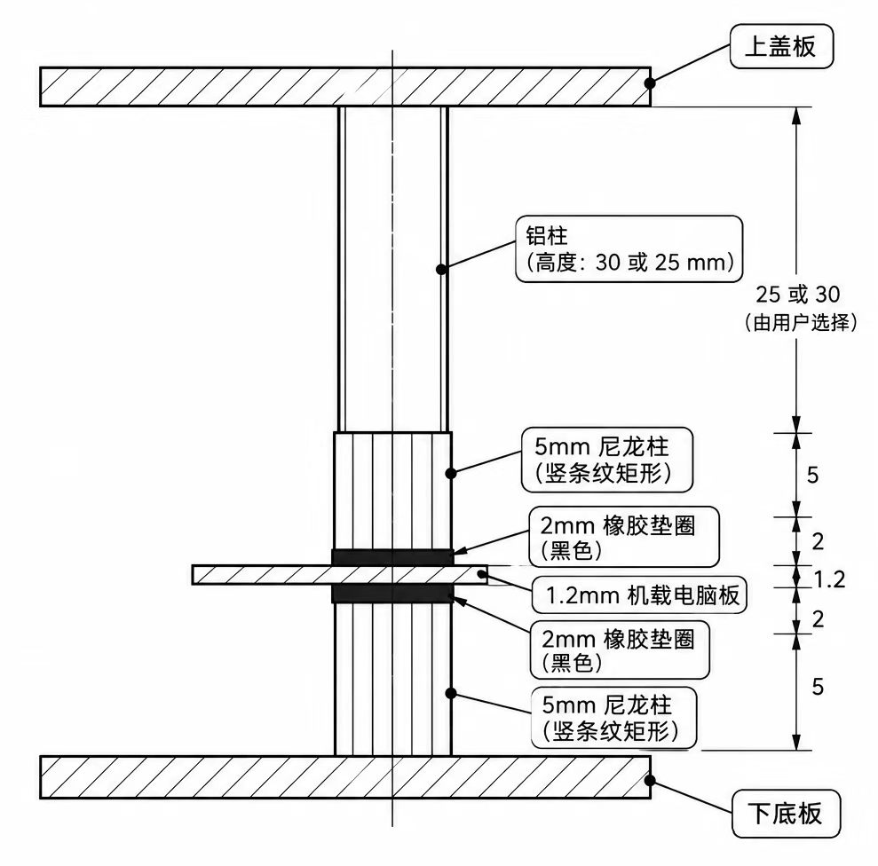
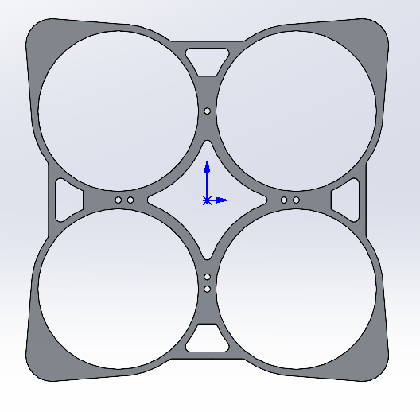
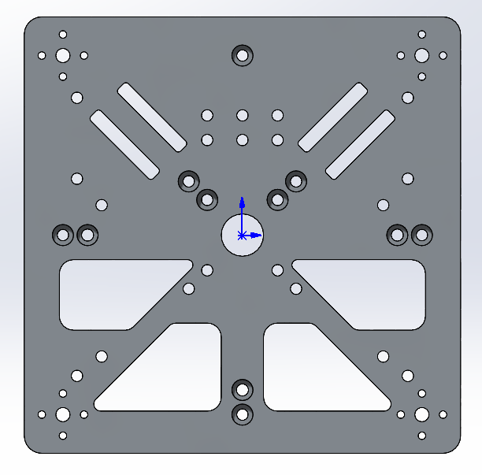
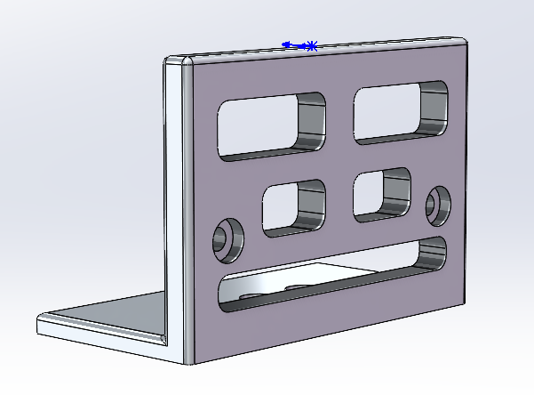
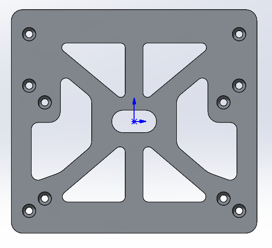

# 3.5 寸机结构件（通用版）

本目录存放 3.5 寸四轴的结构件：SolidWorks 2024 源文件（`.SLDPRT`）和AP214 格式的 STEP 导出（`steps/`）。仓库根目录的 FreeCAD 模型是早期香橙派 5 版本，保留作存档。

---

## 1. 结构组成与连接

| 部件                           | 作用                                                         |
| -------------------------------- | -------------------------------------------------------------- |
| 底座 `base&protector`          | 最底层大件，包裹桨叶，承载全部机上结构                       |
| 下底板 `camera&computer-board` | 上方装机载电脑与相机，下方装电调、飞控并固定电机             |
| 相机保护板 `cameraprotector`   | 与下底板上方连接，固定并保护相机，同时限制机载电脑的安装位置 |
| 上盖板 `upperprotector`        | 顶部大件，保护机载设备并安装电池                             |

电子设备自下而上：四个电机 → 飞控板 → 电调板 → 机载电脑 → 相机 → 电池。

连接方式：

+ 四个电机固定在下底板下方四角安装位置。
+ 飞控板与电调板连接，飞控在下，电调在上。注意飞控板正上方朝向。飞控与电调共8个孔位都需要安装缓震橡胶。
+ 下底板通过8颗螺丝连接飞控与电调。
+ 机载电脑安装在下底板上方的对应孔位，四个角的上下都需要用5mm塑料柱架起以及两个橡胶垫圈缓震。
+ 相机先与相机保护板连接，然后相机保护板再固定在下底板的对应孔位，确保相机保护板能够抵住机载电脑。
+ 电池通过魔术贴绑带与上盖板连接。
+ 上盖板通过铝柱与下底板连接，机载电脑侧铝柱30mm（或25mm，未定），下底板侧铝柱45mm（或40mm，未定）。对于下底板侧铝柱，用橡胶圈抵消1.2mm机载电脑的板载厚度。安装完成后，确保上盖板能够抵住相机保护板。下图为示意（图像由GPT生成，比例上存在误差）
  

---

## 2. 本次改动

**底座**

- 四个边缘向里偏置并加倒角，避免应力集中。
- 中心挖去一个内凹曲边菱形。
- 复核四个电机圆与电机的同轴度：实测中心距离差 1.41mm；底座圆心不便调整，改由下底板电机安装位置对齐。
- 除相机侧外补 3 个安装孔，加强与下底板的连接。

**下底板**

- 补 3 个相机保护板固定孔，使保护板能够抵住机载电脑。
- 除相机侧外补 3 个安装孔，加强与底座的连接。
- 电调连接孔沉头 1.5mm，避免螺丝头突出导致相机保护板与下底板无法贴合。
- 厚度由 3mm 增至 4mm。
- 四个电机安装位置按底座圆心重新对齐。

**相机保护板**

- 高度增至 45mm（若改用 25mm 铝柱则为 40mm，见第 5 节）。
- 相机安装孔沉头 2mm，避免螺丝头突出导致无法抵住机载电脑。

**上盖板**

- 扩大开孔、轻量化，同时保证强度。

---

## 3. 文件清单

| 部件       | SolidWorks 源                                                | STEP 导出                                                            | 包络（mm）                      |
| :----------- | -------------------------------------------------------------- | ---------------------------------------------------------------------- | --------------------------------- |
| 底座       | `base&protector.SLDPRT`                                      | `steps/base&protector.STEP`                                          | 208 × 208 × 34                |
| 下底板     | `camera&computer-board.SLDPRT`                               | `steps/camera&computer-board.STEP`                                   | 124 × 124 × 4                 |
| 相机保护板 | `cameraprotector_40mm.SLDPRT`、`cameraprotector_45mm.SLDPRT` | `steps/cameraprotector_40mm.STEP`、`steps/cameraprotector_45mm.STEP` | 60 × 30 × 40 / 60 × 30 × 45 |
| 上盖板     | `upperprotector.SLDPRT`                                      | `steps/upperprotector.STEP`                                          | 110 × 100 × 3                 |

---

## 4. 装配五金

| 项目                               | 用途                      |
| ------------------------------------ | --------------------------- |
| 18mm 铝柱                          | 连接底座与下底板          |
| 25mm / 30mm / 40mm / 45mm 铝柱    | 上盖板 ↔ 下底板          |
| 5mm 尼龙柱                         | 机载电脑四角上下各一根    |
| m2 缓震橡胶                        | 飞控与电调的 8 个安装孔位 |
| m2x22 螺丝                         | 下底板连接电调 + 飞控     |
| m2x12 / m2x14 / m2x16 / m2x18 螺丝 | 各部位固定                |
| m2 螺母                            | 配合上述 m2 螺丝          |
| 橡胶垫圈                           | 机载电脑安装与缓震        |

---

## 5. 待定与潜在问题

1. **相机安装孔沉头**：需要沉头 2mm，已按此处理。
2. **机载电脑安装孔位的 M3 缓震橡胶**：不再使用，改为两个橡胶垫圈替代。
3. **机载电脑侧铝柱选 30 还是 25**：取决于「机载电脑 + 散热器高度 + 散热余量」是否小于 `25 + 5 + 2`。
   - 若满足，可用 25mm 铝柱，相机保护板取 40mm：`5 × 2 + 25 + 1.2 + 2 × 2 = 40.2 → 40mm`。
   - 否则用 30mm 铝柱，相机保护板取 45mm：`5 × 2 + 30 + 1.2 + 2 × 2 = 45.2 → 45mm`。
